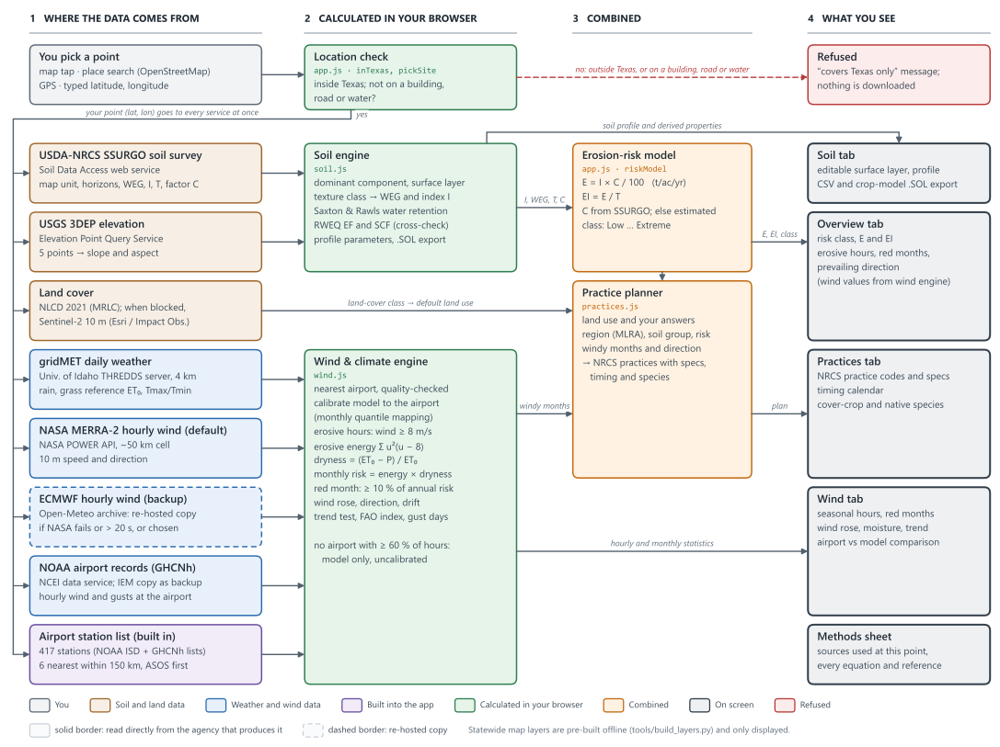
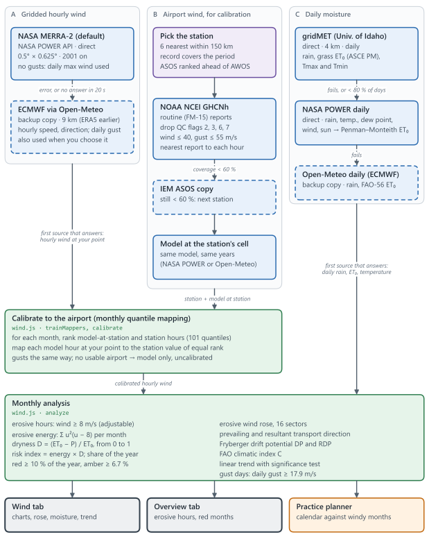
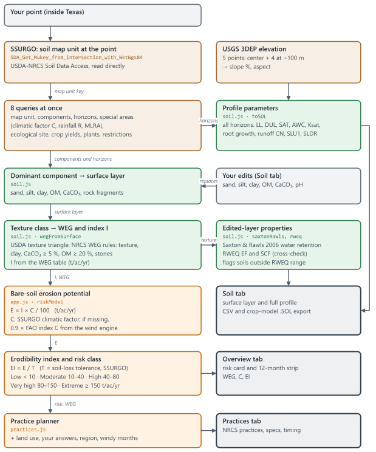
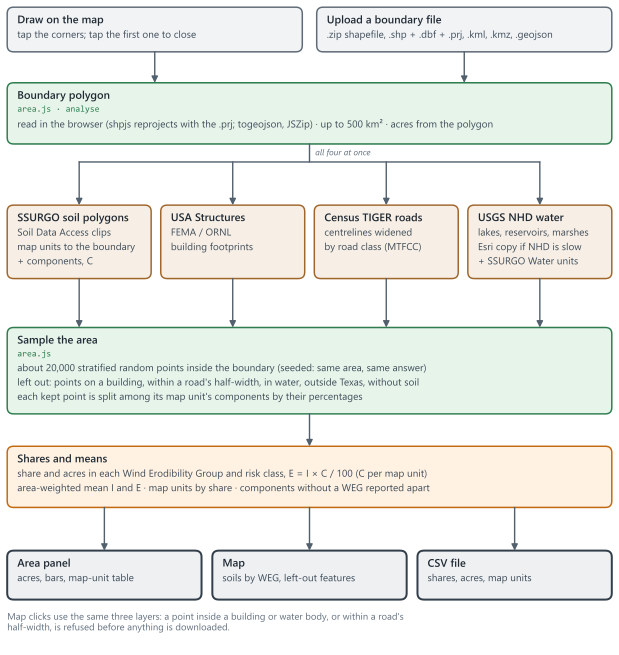

# WindGuard TX

Mobile-friendly web app that shows where Texas is most prone to wind erosion and builds a site-specific control plan for any point you pick.

Tap the map, search a place, use GPS, or type coordinates. Points outside the Texas outline are refused, and so are map clicks on a building, a road or water; search lists Texas places only. The area tool analyses a whole field or ranch instead of one point. The app then pulls the soil survey, 10 years of hourly wind and the land cover for that point. It shows the risk, the wind-prone months, the full soil profile, and practices matched to the land use you choose.

## Run it

It is a static site with no build step and no API keys. Serve the folder with any web server:

```bash
python -m http.server 8765
```

Then open <http://localhost:8765>. Opening `index.html` straight from disk also works in most browsers, but a server is more reliable. To link straight to a location, use `?lat=32.74&lon=-101.95`. Add `&from=2024-01-01&to=2024-12-31` (or `&period=5` or `&period=20`) for the wind period and `&model=ecmwf` for ECMWF wind; the address keeps both as you change them, so a copied link redoes the same analysis.

To put it on a phone, host the folder on any static host (GitHub Pages, Netlify, S3), open it on the phone, and choose "Add to Home Screen". Wrapping it as a store app later (Capacitor/Cordova) needs no code changes.

## What it shows

| Tab | Content |
|---|---|
| Map | Only the chosen state is shown: the state picker next to the logo lists every state, Texas is the one available now, and everything outside it is covered and can't be panned to. Satellite imagery (Esri), with switchable USGS imagery+topo, OpenStreetMap streets and USGS topo bases. Overlays: place, river and county names; roads and street names; NHD rivers and streams; county lines (U.S. Census TIGER, on by default, exact at every zoom); statewide susceptibility, soil Wind Erodibility Group and climatic factor C; NLCD 2021 land cover; SSURGO map-unit lines at zoom 13+ (off by default). |
| Overview | Bare-soil risk (WEQ E = I × C/100) in t/ac/yr, with the five risk classes shown under it and this site's class lit; erodibility index C·I/T; mean wind; erosive-wind hours; prevailing erosive direction; Wind Erodibility Group (nine classes from 1, most erodible, to 8, not erodible), with I (0–310); NRCS climatic factor C (Garden City, KS = 100; Texas 4–150); land cover; and a 12-month risk strip (red = high-risk months, ranked when the period covers all 12 months). Each score shows its scale or range. |
| Wind | Seasonal erosive-wind hours (red/amber/gray by risk), wind and gust climatology, gust days, erosive wind rose with the resultant soil-transport direction, precipitation vs ET₀, year-to-year trend with significance test, and indices (Fryberger drift potential, FAO climatic index, barrier orientation). You can switch the wind source (calibrated to the nearest airport, airport only, or gridded model only), the gridded model (NASA MERRA-2 directly by default, or ECMWF via Open-Meteo), the calibration station, the period (the last 5, 10 or 20 complete years, or your own dates: 30 days or more inside the model's record, with 20 or more in one calendar month), units and erosive threshold. A comparison card shows the reanalysis against the airport station. |
| Soil | Dominant SSURGO component and map unit, and an editable surface layer (sand, silt, clay, OM, CaCO₃, pH) that recalculates texture class, WEG and I, RWEQ erodible fraction and crust factor, and water properties (Saxton & Rawls 2006). The **+** expander opens the full profile: horizons with texture, bulk density, LL/DUL/SAT, AWC, Ksat, pH, CEC, CaCO₃, gypsum, EC, SAR, coarse fragments, root growth factor, estimated N; plus classification, slope (survey and USGS 3DEP), restrictive layer, drainage rate, runoff curve number, albedo, evaporation limit, T and Kw factors, capability class, components, crop yields and the reference plant community. Exports to CSV and to a crop-model `.SOL` file. A table explains the nine Wind Erodibility Groups (1 most erodible to 8 not erodible, with each group's I and NRCS's texture guide) and marks this soil's group; the app labels a soil's group by number and I, because a survey's group can differ from what the soil's texture alone suggests (Pullman clay loam is WEG 7). |
| Methods sheet | The page icon on the map, or the links under each result, opens a sheet listing which source supplied each value at this location, the scale and classes of every number (with the full NRCS definitions of the Wind Erodibility Groups), the full data-source catalog, and every equation with its terms, units and reference. |
| Area tool | The polygon button on the map. Draw a field or upload a boundary (zipped shapefile, .shp + .dbf + .prj, .kml, .kmz or .geojson; up to 500 km²). The panel shows total and analysed acres, the share and acres in each Wind Erodibility Group and bare-soil risk class (E = I × C / 100), area-weighted mean I and E, and the soil map units, with buildings, roads and water left out. Soil map units are coloured by WEG on the map. CSV export. |
| Practices | Pick a land use (cropland, rangeland, shrubland, pasture/hay, CRP/go-back, disturbed land, bare sand) and answer 2–5 quick questions. You get a prioritized plan with NRCS practice codes, quantitative specs, a timing calendar against the local windy months, cover-crop and native-species tables for the region and soil group, and site notes. |
| Units table | The ruler button on the map. Pick metric, US or the default mix in one click, or a unit for each quantity (wind, rain, temperature, elevation, soil depth, water, Ksat, area, distances, soil loss, rates, seeding density, solar radiation). Every number, chart, table, legend and download follows it; `?units=metric` or `?units=us` in the link sets it. |
| Downloads | Each chart has a download button: PNG, TIFF or JPEG at a chosen size (inches, cm, mm or pixels) and 72–1,200 DPI, with the DPI stored in the file; the wind rose also as SVG; every chart and table as CSV. The data sheet (download button in the panel) writes model-ready files, below. |

## Model-ready soil and weather files

The data sheet builds a zip for the chosen location and dates:

| Model | Files |
|---|---|
| DSSAT 4.8 | one `.WTH` per year (and one for all years), soil `WG.SOL` |
| SWAT+ | station files (`.pcp`, `.tem`, `.slr`, `.hmd`, `.wnd`) with their `.cli` lists, `weather-sta.cli`, `weather-wgn.cli`, `soils.sol`, a QSWAT+ user soil table, and the SWAT2012 text format |
| EPIC 1102, APEX 1501 | daily `.DLY`, monthly statistics `.WP1`, wind `.WND`, soil `.SOL` |
| APSIM Next Gen / 7.10 | weather `.met` with a CO₂ column, soil `.apsimx` |
| AquaCrop 7 | climate `.CLI` with `.Tnx`, `.ETo` and `.PLU`, soil `.SOL`, and an AquaCrop-OSPy weather file |
| Plain CSV | daily weather and soil layers with units, and a README (ET₀ source, layers) |

- **Weather:** gridMET (4 km, 1979 to about 2 days ago), NASA POWER (1981 to about a week ago), or your own daily file (CSV, text or Excel, including NASA POWER, Open-Meteo, Campbell TOA5, GHCN, CIMIS, Davis and similar exports; columns found by name, and the sheet and README show which header each was read from and anything worth noting, such as a TOA5 day stamped at midnight being the day before; °C/°F, mm/in and the usual solar and wind units), with gaps optionally filled from gridMET. Grass ET₀ is the file's own column, or FAO-56 from its columns, and the README counts the days. Dates outside the source's record are left out. Codes such as −99.9 or −996 are taken as missing. DSSAT, APSIM and AquaCrop cannot read missing values, so their files run from the first to the last day with Tmax and Tmin, with gaps filled and counted in the README.
- **Soil:** any component of the survey's map unit, or your own profile in an editable table (start from the survey, change values, add layers or load a CSV with lab spellings such as "pH (H2O)", "ECe" or "Upper depth", and units such as g/kg, cm/h or inches in the headers; blanks are estimated with Saxton & Rawls 2006, kept physical for any texture; the curve number follows the hydrologic group and slope). Your profile belongs to the location it was made for.
- **Layers:** each model's usual layers, the horizons as they are, or custom depths you type (with SoilGrids and DSSAT presets). Each custom layer takes the thickness-weighted mean of the horizons it covers (Ksat as a harmonic mean). The profile stops at bedrock or a cemented layer; a profile that simply ends is extended with its deepest horizon.
- When the dates do not cover every month, or lack a variable the weather-generator statistics need, 10 complete years are read for TAV/AMP and those statistics. Failing that, months with 10 or more days are used, with a note. A model that still cannot get them gets a `NOT_WRITTEN.txt` saying why, instead of files with zeros; the rest of the zip is kept.
- Every file follows its model's manual, official example files and the reading code of its source (`docs/METHODS.md` §7). Each folder has a README with how to load the files and the soil layers that model's file has. The files have not been run in the models here.

## Data sources (all open, no keys)

Every default source is read directly from the agency that produces it. Open-Meteo is only a backup: for hourly wind when NASA POWER errors or has not answered within 20 s, for daily weather when gridMET and NASA POWER both fail, and for elevation when USGS fails. You can still pick ECMWF wind (Open-Meteo's copy) on the Wind tab; ECMWF and the Copernicus CDS themselves need a personal key and queued jobs.

| Data | Producer | How the app reads it | If it fails |
|---|---|---|---|
| Hourly 10 m wind (default) | NASA MERRA-2, 0.5° × 0.625° | NASA POWER hourly API, direct | ECMWF via Open-Meteo (after 20 s without an answer) |
| Hourly 10 m wind (backup or option) | ECMWF IFS 9 km (2017 on), ERA5 0.25° (before) | Open-Meteo Historical Weather API (copy) | NASA MERRA-2 |
| Airport observations | NWS/FAA ASOS/AWOS, NOAA NCEI GHCNh | NCEI Access Data Service, direct | Iowa Environmental Mesonet ASOS archive |
| Daily precipitation, grass ET₀, temperature | gridMET 4 km (University of Idaho) | THREDDS OPeNDAP, direct | NASA POWER daily, direct (Penman–Monteith ET₀ computed in the app), then ECMWF daily via Open-Meteo |
| Soils, WEG, I, T, climatic factor C | USDA-NRCS SSURGO | Soil Data Access, direct | none |
| Elevation and slope | USGS 3DEP (1–10 m) | Elevation Point Query Service, direct | Copernicus 90 m DEM via Open-Meteo |
| Land cover | USGS/MRLC NLCD 2021 | MRLC WMS, direct (currently refuses browser requests) | Sentinel-2 10 m land cover (Impact Observatory, Microsoft, Esri) |
| Soil polygons in an area | USDA-NRCS SSURGO | Soil Data Access spatial query (clipped to the boundary), direct | none |
| Buildings (area tool, click check) | FEMA/ORNL USA Structures | ArcGIS feature service, direct | not removed; the panel says so |
| Roads (area tool, click check) | Census TIGER/Line | TIGERweb map service, direct; widened by road class | not removed; the panel says so |
| Water bodies (area tool, click check) | USGS NHD (lakes/ponds, reservoirs, marshes; playas stay in), plus SSURGO Water map units | NHD map service, direct | Esri's copy of NHD after 5 s (3 s for a click) |
| Boundary files | your shapefile, KML/KMZ or GeoJSON | read in the browser (shpjs, togeojson, JSZip); never uploaded | — |
| Statewide WEI/WEG grids | SSURGO via UC Davis SoilWeb | pre-built in `data/` | — |
| Geocoding, basemaps | OpenStreetMap Nominatim; Esri, USGS | direct | — |
| County lines | U.S. Census TIGER | TIGERweb map service, drawn per tile, direct | — |
| Daily weather for model files | gridMET (default), NASA POWER, or your file | THREDDS OPeNDAP (9 variables) or POWER daily API, direct | NASA POWER |
| Atmospheric CO₂ (APSIM files) | NOAA GML Mauna Loa annual means | built in (1979–2025; +2.5 ppm/yr after) | — |

The station list (airports with NOAA GHCNh ids, and West Texas Mesonet towers) is in `data/stations.js` (`tools/fetch_stations.py`).

### Other wind networks

Calibration uses airports. Other networks were checked in October 2026 (details in `docs/METHODS.md` §3):

- **West Texas Mesonet** (Texas Tech, 189 towers at 10 m) is the one network with 10 m wind that a web page can read without a key or licence. Some towers read like the airports (Reese Center vs Lubbock airport: 0.99 of the mean wind and 1.00–1.03 times the hours ≥ 8 m/s in 2020 and 2025), but in a 2024 survey 7 of 16 towers recorded 24–85% fewer erosive hours than a nearby airport, relative to the model: probably sheltered. Its [data policy](https://www.mesonet.ttu.edu/disclaimer) forbids public use without the mesonet's permission (mesonet@ttu.edu), so it is **switched off**. The code is in place: set `ENABLE_WTM = true` in `js/wind.js` once the mesonet agrees. For a local test, run the app as above and open <http://localhost:8765/?wtm=1>; the public site ignores `?wtm=1`.
  - When on, a tower ranks ahead of an airport when its distance plus 20 km is less than the airport's (an AWOS airport counts 100 km extra). Such a tower refines the calibration about a minute after the airport result appears, if it records at least 0.85 times the airport's erosive hours relative to the model; otherwise the app checks one more tower, then keeps the airport. A tower is used unchecked only when no airport was found.
  - A tower needs 5 complete years in the archive (132 of 189 in 2026) and trains on them. Gusts stay with the airport.
- **Not usable:** TexMesonet (TWDB) and the West Texas Mesonet website refuse other websites; RAWS and NRCS SCAN read 20–50% low even after height correction at the 2 RAWS and 3 SCAN sites tested; USCRN is at 1.5 m; Synoptic needs a paid key; the Oklahoma Mesonet and TexasET need a licence.

## How the data flows

[`docs/WindGuard_TX_Data_Flow.docx`](docs/WindGuard_TX_Data_Flow.docx) has these diagrams and tables showing where each dataset comes from, where it is calculated, and how each result reaches the screen. Rebuild it with `python tools/build_flow_doc.py`. The diagrams are vector drawings, sharp at any zoom: click one to open it on its own. 600 dpi PNG copies are next to them in `docs/img/`.

[](docs/img/flow_overview.svg)

<details>
<summary>The wind, soil and area pipelines</summary>

**Wind and climate: three sources to monthly risk**

[](docs/img/flow_wind.svg)

**Soil survey to erosion risk**

[](docs/img/flow_soil.svg)

**Field or area analysis, and the map-click check**

[](docs/img/flow_area.svg)

</details>

## Rebuilding the statewide layers

`tools/` contains the scripts that produced `data/` (Python 3.11 with numpy, rasterio, shapely, pyproj, scipy, Pillow, requests):

```bash
python tools/fetch_power_grid.py
python tools/fetch_county_c.py
python tools/build_layers.py
```

The raw downloads (SoilWeb rasters, Census boundaries) go in `tools/raw/`. The URLs are listed in the script docstrings.

## Method notes and limits

- The bare-soil potential is WEQ E3 with K = 1: a bare, smooth, wide, unsheltered field. It ranks inherent susceptibility. It does not predict actual loss under current management.
- Gridded winds are averaged over a 9–50 km cell and miss many gusty hours. At Lubbock the raw reanalysis caught only 35% of the airport's erosive hours over 2016–2025, and it shifted the peak months earlier (Jan–Apr instead of Feb–May). The app therefore calibrates speeds month by month to the nearest airport station by default. Directions agree well either way. After calibration the default NASA MERRA-2 and the optional ECMWF give 1,295 and 1,291 erosive h/yr at Lubbock, both Feb–Apr from the WSW.
- "High-risk" months are those with at least 10% of the year's erosive wind energy (Σu²(u−uₜ) above the threshold) weighted by dryness (1 − P/ET₀). They are ranked only for a period that covers all 12 months.
- The recommendations are planning guidance drawn from NRCS standards and Texas research. `docs/RESEARCH.md` holds the full evidence report, and `docs/METHODS.md` lists every formula and threshold the app uses. Confirm designs and seeding rates with the local NRCS field office.
- The default lookup uses no Open-Meteo calls. If you pick ECMWF, a 10-year lookup counts as about 130 Open-Meteo calls against the free limit of 10,000 per day per IP, roughly 75 new locations a day; if Open-Meteo refuses, the app switches to NASA MERRA-2.
