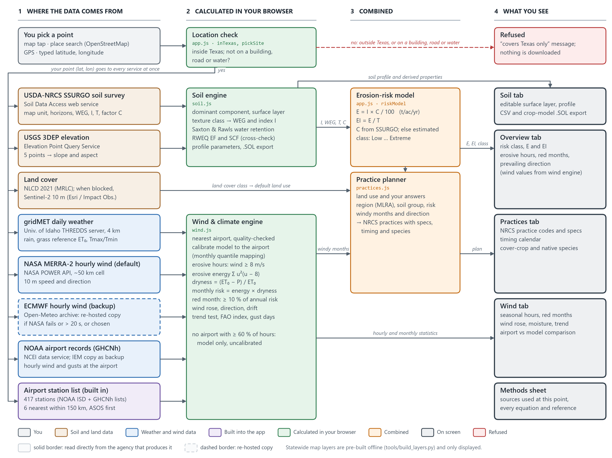

# WindGuard TX

Mobile-friendly web app that shows where Texas is most prone to wind erosion and builds a site-specific control plan for any point you pick.

Tap the map, search a place, use GPS, or type coordinates. Points outside the Texas outline are refused, and so are map clicks on a building, a road or water; search lists Texas places only. The area tool analyses a whole field or ranch instead of one point. The app then pulls the soil survey, 10 years of hourly wind and the land cover for that point. It shows the risk, the wind-prone months, the full soil profile, and practices matched to the land use you choose.

## Run it

It is a static site with no build step and no API keys. Serve the folder with any web server:

```bash
python -m http.server 8765
```

Then open <http://localhost:8765>. Opening `index.html` straight from disk also works in most browsers, but a server is more reliable. To link straight to a location, use `?lat=32.74&lon=-101.95`.

To put it on a phone, host the folder on any static host (GitHub Pages, Netlify, S3), open it on the phone, and choose "Add to Home Screen". Wrapping it as a store app later (Capacitor/Cordova) needs no code changes.

## What it shows

| Tab | Content |
|---|---|
| Map | Satellite imagery (Esri), with switchable USGS imagery+topo, OpenStreetMap streets and USGS topo bases. Overlays: place, river and county names; roads and street names; NHD rivers and streams; county lines; statewide susceptibility, soil Wind Erodibility Group and climatic factor C; NLCD 2021 land cover; SSURGO map-unit lines at zoom 13+. |
| Overview | Bare-soil risk (WEQ E = I × C/100), erodibility index C·I/T, mean wind, erosive-wind hours, prevailing erosive direction, WEG, NRCS C, land cover, and a 12-month risk strip (red = high-risk months). |
| Wind | Seasonal erosive-wind hours (red/amber/gray by risk), wind and gust climatology, gust days, erosive wind rose with the resultant soil-transport direction, precipitation vs ET₀, year-to-year trend with significance test, and indices (Fryberger drift potential, FAO climatic index, barrier orientation). You can switch the wind source (calibrated to the nearest airport, airport only, or gridded model only), the gridded model (NASA MERRA-2 directly by default, or ECMWF via Open-Meteo), the calibration station, the period (5/10/20 yr), units and erosive threshold. A comparison card shows the reanalysis against the airport station. |
| Soil | Dominant SSURGO component and map unit, and an editable surface layer (sand, silt, clay, OM, CaCO₃, pH) that recalculates texture class, WEG and I, RWEQ erodible fraction and crust factor, and water properties (Saxton & Rawls 2006). The **+** expander opens the full profile: horizons with texture, bulk density, LL/DUL/SAT, AWC, Ksat, pH, CEC, CaCO₃, gypsum, EC, SAR, coarse fragments, root growth factor, estimated N; plus classification, slope (survey and USGS 3DEP), restrictive layer, drainage rate, runoff curve number, albedo, evaporation limit, T and Kw factors, capability class, components, crop yields and the reference plant community. Exports to CSV and to a crop-model `.SOL` file. |
| Methods sheet | The page icon on the map, or the links under each result, opens a sheet listing which source supplied each value at this location, the full data-source catalog, and every equation with its terms, units and reference. |
| Area tool | The polygon button on the map. Draw a field or upload a boundary (zipped shapefile, .shp + .dbf + .prj, .kml, .kmz or .geojson; up to 500 km²). The panel shows total and analysed acres, the share and acres in each Wind Erodibility Group and bare-soil risk class (E = I × C / 100), area-weighted mean I and E, and the soil map units, with buildings, roads and water left out. Soil map units are coloured by WEG on the map. CSV export. |
| Practices | Pick a land use (cropland, rangeland, shrubland, pasture/hay, CRP/go-back, disturbed land, bare sand) and answer 2–5 quick questions. You get a prioritized plan with NRCS practice codes, quantitative specs, a timing calendar against the local windy months, cover-crop and native-species tables for the region and soil group, and site notes. |

## Data sources (all open, no keys)

Every default source is read directly from the agency that produces it. Open-Meteo is only a backup: for hourly wind when NASA POWER errors or has not answered within 20 s, for daily weather when gridMET and NASA POWER both fail, and for elevation when USGS fails. You can still pick ECMWF wind (Open-Meteo's copy) on the Wind tab; ECMWF and the Copernicus CDS themselves need a personal key and queued jobs.

| Data | Producer | How the app reads it | If it fails |
|---|---|---|---|
| Hourly 10 m wind (default) | NASA MERRA-2, 0.5° × 0.625° | NASA POWER hourly API, direct | ECMWF via Open-Meteo (after 20 s without an answer) |
| Hourly 10 m wind (backup or option) | ECMWF IFS 9 km (2017 on), ERA5 0.25° (before) | Open-Meteo Historical Weather API (copy) | NASA MERRA-2 |
| Airport observations | NWS/FAA ASOS/AWOS, NOAA NCEI GHCNh | NCEI Access Data Service, direct | Iowa Environmental Mesonet ASOS archive |
| Daily precipitation, grass ET₀, temperature | gridMET 4 km (University of Idaho) | THREDDS OPeNDAP, direct | NASA POWER daily, direct (Penman–Monteith ET₀ computed in the app), then ECMWF daily via Open-Meteo |
| Soils, WEG, I, T, climatic factor C | USDA-NRCS SSURGO | Soil Data Access, direct | none |
| Elevation and slope | USGS 3DEP (1–10 m) | Elevation Point Query Service, direct | Copernicus 90 m DEM via Open-Meteo |
| Land cover | USGS/MRLC NLCD 2021 | MRLC WMS, direct (currently refuses browser requests) | Sentinel-2 10 m land cover (Impact Observatory, Microsoft, Esri) |
| Soil polygons in an area | USDA-NRCS SSURGO | Soil Data Access spatial query (clipped to the boundary), direct | none |
| Buildings (area tool, click check) | FEMA/ORNL USA Structures | ArcGIS feature service, direct | not removed; the panel says so |
| Roads (area tool, click check) | Census TIGER/Line | TIGERweb map service, direct; widened by road class | not removed; the panel says so |
| Water bodies (area tool, click check) | USGS NHD (lakes/ponds, reservoirs, marshes; playas stay in), plus SSURGO Water map units | NHD map service, direct | Esri's copy of NHD after 5 s (3 s for a click) |
| Boundary files | your shapefile, KML/KMZ or GeoJSON | read in the browser (shpjs, togeojson, JSZip); never uploaded | — |
| Statewide WEI/WEG grids | SSURGO via UC Davis SoilWeb | pre-built in `data/` | — |
| Geocoding, basemaps | OpenStreetMap Nominatim; Esri, USGS | direct | — |

The station list with NOAA GHCNh ids is in `data/stations.js` (`tools/fetch_stations.py`).

## How the data flows

[`docs/WindGuard_TX_Data_Flow.docx`](docs/WindGuard_TX_Data_Flow.docx) has three diagrams and tables showing where each dataset comes from, where it is calculated, and how each result reaches the screen. Rebuild it with `python tools/build_flow_doc.py`.



## Rebuilding the statewide layers

`tools/` contains the scripts that produced `data/` (Python 3.11 with numpy, rasterio, shapely, pyproj, scipy, Pillow, requests):

```bash
python tools/fetch_power_grid.py
python tools/fetch_county_c.py
python tools/build_layers.py
```

The raw downloads (SoilWeb rasters, Census boundaries) go in `tools/raw/`. The URLs are listed in the script docstrings.

## Method notes and limits

- The bare-soil potential is WEQ E3 with K = 1: a bare, smooth, wide, unsheltered field. It ranks inherent susceptibility. It does not predict actual loss under current management.
- Gridded winds are averaged over a 9–50 km cell and miss many gusty hours. At Lubbock the raw reanalysis caught only 35% of the airport's erosive hours over 2016–2025, and it shifted the peak months earlier (Jan–Apr instead of Feb–May). The app therefore calibrates speeds month by month to the nearest airport station by default. Directions agree well either way. After calibration the default NASA MERRA-2 and the optional ECMWF give 1,295 and 1,291 erosive h/yr at Lubbock, both Feb–Apr from the WSW.
- "High-risk" months are those with at least 10% of the year's erosive wind energy (Σu²(u−uₜ) above the threshold) weighted by dryness (1 − P/ET₀).
- The recommendations are planning guidance drawn from NRCS standards and Texas research. `docs/RESEARCH.md` holds the full evidence report, and `docs/METHODS.md` lists every formula and threshold the app uses. Confirm designs and seeding rates with the local NRCS field office.
- The default lookup uses no Open-Meteo calls. If you pick ECMWF, a 10-year lookup counts as about 130 Open-Meteo calls against the free limit of 10,000 per day per IP, roughly 75 new locations a day; if Open-Meteo refuses, the app switches to NASA MERRA-2.
